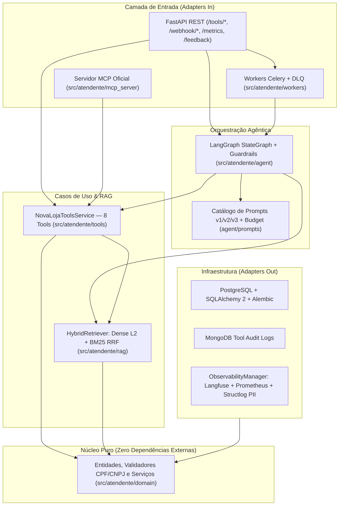
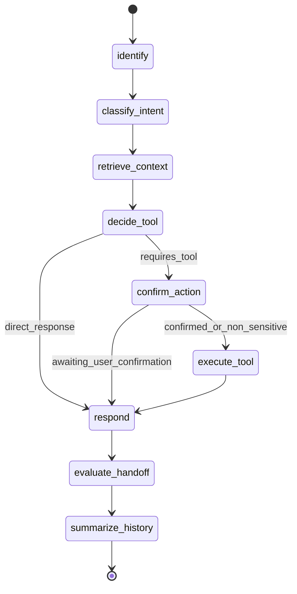

# Atendente IA — Plataforma Agêntica B2C & B2B da NovaLoja

Sistema agêntico de atendimento ao cliente em produção para a **NovaLoja** (e-commerce de eletrônicos **B2C** e assinaturas corporativas de infraestrutura/SaaS **B2B**), construído em **Python 3.12+** com **Arquitetura Hexagonal**, **LangGraph**, **RAG Híbrido (pgvector + BM25 RRF)**, **Function Calling tipado (8 Tools + Servidor MCP Oficial)**, **Webhooks Assíncronos (HMAC-SHA256 + Celery + Redis + DLQ)**, **Observabilidade (Langfuse + Prometheus + Grafana)** e **Suíte de 85 Evals com LLM-as-a-Judge calibrado**.

---

## 1. Guia Rápido de 5 Minutos (Quickstart)

### Pré-requisitos
- Python `>= 3.12` e [`uv`](https://docs.astral.sh/uv/)
- Docker e Docker Compose

### Passo a Passo
```bash
# 1. Instalar dependências e ambiente virtual
uv sync --all-extras

# 2. Subir infraestrutura (Postgres/pgvector, MongoDB, Redis, Langfuse, Prometheus, Grafana)
docker compose up -d

# 3. Executar suíte de verificação completa (Lint, Typecheck estrito, Import-Linter e 101 Testes)
uv run ruff check .
uv run mypy --strict src
uv run lint-imports
uv run pytest --cov=src/atendente --cov-report=term-missing

# 4. Rodar a suíte de 85 Evals com avaliador determinístico + LLM-as-a-Judge calibrado
uv run python -m evals.runners.run_evals

# 5. Iniciar a API FastAPI localmente
uv run uvicorn atendente.api.main:app --reload --port 8000
```

---

## 2. Arquitetura do Sistema

### 2.1 Arquitetura Hexagonal e Isolamento de Camadas (`.importlinter`)


### 2.2 Topologia do Grafo de Conversação (`LangGraph`)


---

## 3. Roteiro de Demonstração (Demo Script)

1. **Inspeção dos Schemas de Function Calling:**
   - `GET http://localhost:8000/tools/schemas` retorna os 8 contratos JSON Schema canônicos (`identificar_cliente`, `consultar_pedido`, `solicitar_reembolso`, `abrir_chamado`, `consultar_contrato_sla`, `consultar_fatura`, `buscar_base_conhecimento`, `transferir_para_humano`).
2. **Jornada B2C com Gatekeeper de Ação Sensível (`solicitar_reembolso`):**
   - O cliente identifica-se por CPF (`529.982.247-25`), consulta o pedido `ord_b2c_recent` e pede estorno por defeito. O nó `confirm_action` bloqueia a execução imediata e solicita confirmação explícita (`CONFIRMO`). Apenas após a confirmação no turno seguinte o estorno é gravado e auditado.
3. **Jornada B2B Corporativa (`consultar_contrato_sla`, `consultar_fatura`, `abrir_chamado`):**
   - A empresa `XPTO Indústria` (`11.222.333/0001-81`) consulta seu contrato Enterprise (`resolution_sla_hours=4`), verifica faturas em aberto e abre chamado de prioridade crítica.
4. **Recepção de Webhook Assíncrono com HMAC-SHA256 e Anti-Replay:**
   - `POST /webhook/messages` valida `X-Hub-Signature-256` em tempo constante (`hmac.compare_digest`), rejeita timestamps com mais de 300s, garante idempotência (`SETNX`) e responde `202 Accepted` em `< 20 ms`.
5. **Conversão de Trace de Produção em Teste (`trace-to-test`):**
   - `make trace-to-test TRACE_ID=trc-prod-001` converte instantaneamente um trace em caso de regressão JSON em `evals/datasets/`.

---

## 4. Métricas Empíricas (Antes e Depois)

### 4.1 Evolução da Engenharia de Prompts (`docs/EVALS.md`)
| Versão | Perfil | Abstenção | Citação `[Fonte: ...]` | Defesa Anti-Injection | Ação Sensível Segura | Isolamento B2C/B2B | Score Global |
|---|---|---|---|---|---|---|---|
| **`v1.0.0`** | Ingênuo (1 frase) | 0.00 | 0.00 | 0.00 | 0.00 | 0.00 | **0.00** |
| **`v2.0.0`** | Estruturado sem delimitadores XML | 1.00 | 0.00 | 0.00 | 1.00 | 1.00 | **0.60** |
| **`v3.0.0`** | Produção (`<contexto_seguro>` + Checklist) | **1.00** | **1.00** | **1.00** | **1.00** | **1.00** | **1.00** |

### 4.2 Benchmark de Chunking RAG (`docs/adr/0004-chunking-strategy.md`)
| Configuração | Tamanho / Overlap | Total de Chunks | Hit Rate@3 | MRR | Decisão |
|---|---|---|---|---|---|
| Config A | 256 / 32 tokens | 59 | 0.90 | 0.90 | Descartada (fragmentação excessiva de tabelas SLA) |
| **Config B** | **512 / 64 tokens** | **42** | **0.90** | **0.90** | **Escolhida (melhor relação sinal/ruído e preservação de seções)** |
| Config C | 1024 / 128 tokens | 30 | 0.90 | 0.90 | Descartada (maior consumo de orçamento de contexto) |

### 4.3 Suíte de 85 Evals e Latência da API (`docs/SHIP_REPORT.md`)
- **Casos Avaliados:** `85` (`evals/datasets/novaloja_eval_dataset.json`)
- **Acurácia de Intenção / Tool / Handoff / Abstenção:** `100%`
- **Taxa de Violação de Ação Sensível Sem Confirmação:** `0.00%`
- **Calibração do LLM-as-a-Judge (`HUMAN_CALIBRATION_SAMPLE`):** Concordância `100%` (`MAE = 0.00`)
- **Latência da API (excluindo LLM externo):** `p50 < 20 ms`, `p95 < 50 ms` (SLA `< 300 ms`)

---

## 5. Decisões Arquiteturais e Trade-offs (`docs/adr/`)

- **[ADR-0001 (Bancos de Dados)](docs/adr/0001-database-strategy.md):** Separação poliglota entre PostgreSQL (transacional ACID para pedidos, faturas e contratos) e MongoDB (logs imutáveis de auditoria de Tools com schema flexível).
- **[ADR-0002 (Busca Vetorial e Híbrida)](docs/adr/0002-vector-database-and-hybrid-search.md):** Uso de `pgvector` + busca léxica BM25 combinados via *Reciprocal Rank Fusion* (`RRF, k=60`) para capturar tanto similaridade semântica quanto códigos exatos de produtos/cláusulas.
- **[ADR-0003 (Orquestração Agêntica)](docs/adr/0003-agent-orchestration-langgraph.md):** Adoção do `LangGraph` com `ConversationState` tipado em vez de loops `while` ad-hoc, permitindo inspeção por nó, checkpointing determinístico e gatekeeper formal de ações sensíveis.
- **[ADR-0004 (Estratégia de Chunking)](docs/adr/0004-chunking-strategy.md):** Particionamento semântico por cabeçalhos Markdown (`#`, `##`, `###`) com *breadcrumbs* hierárquicos e janela de 512 tokens / 64 de sobreposição.
- **[ADR-0005 (Filas e Webhooks)](docs/adr/0005-async-queue-and-webhooks.md):** Desacoplamento da recepção HTTP (`< 50ms`) via Celery + Redis com idempotência `SETNX` e Dead Letter Queue (`dlq_unhandled_messages`).

---

## 6. Melhorias Futuras Priorizadas

1. **Reranker Cross-Encoder Local (P1):** Adicionar etapa de reranking leve (ex.: `bge-reranker-v2-m3`) sobre o top-10 do RRF para elevar ainda mais a precisão em consultas multi-documento complexas.
2. **Streaming Server-Sent Events (SSE) / WebSockets (P2):** Expor endpoint de streaming token-a-token do nó `respond` para interfaces de chat web em tempo real.
3. **Avaliação Contínua Online em Amostragem de Produção (P3):** Executar o `LLMJudge` assincronamente via worker Celery sobre 10% dos traces reais coletados no Langfuse.
