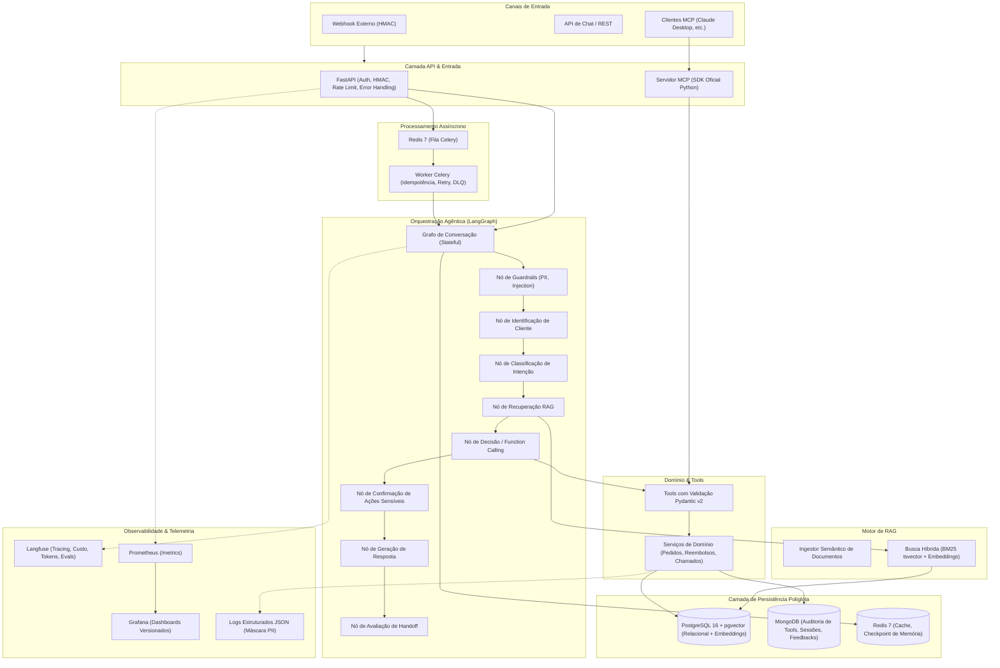
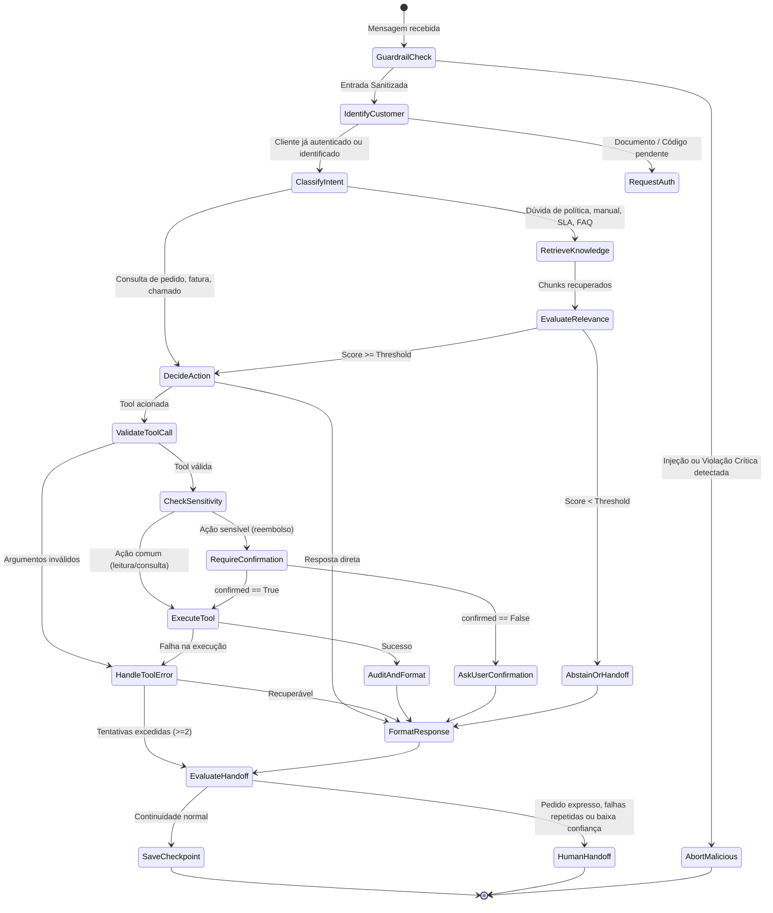

# Arquitetura do Sistema — Atendente IA

Este documento especifica a topologia, fluxo de dados, padrão de camadas e fronteiras do sistema **Atendente IA**. O design segue estritamente a **Arquitetura Hexagonal (Ports & Adapters)**, garantindo que regras de negócio permaneçam puras, testáveis e independentes de frameworks de orquestração, bancos de dados ou provedores de LLM.

---

## 1. Visão Geral dos Componentes

---

## 2. Fluxo de Conversação no LangGraph

O grafo de atendimento implementa uma máquina de estados com transições condicionais bem definidas. As ações sensíveis (como `solicitar_reembolso`) nunca são executadas sem a presença explícita de aprovação no estado.

---

## 3. Estado Central da Sessão (`ConversationState`)

O estado da conversação é tipado via `TypedDict` / Pydantic com esquema estrito:

| Campo | Tipo | Descrição |
|---|---|---|
| `customer` | `Optional[Customer]` | Dados cadastrais e segmento (`B2C` ou `B2B`) |
| `segment` | `Literal["B2C", "B2B", "UNKNOWN"]` | Segmento operacional ativo |
| `authenticated` | `bool` | Status de validação de CPF/CNPJ e código |
| `intent` | `str` | Intenção classificada (ex.: `order_tracking`, `refund`, `sla_query`) |
| `messages` | `list[BaseMessage]` | Histórico recente de mensagens (janela deslizante) |
| `summary` | `str` | Resumo incremental condensado de turnos antigos |
| `retrieved_docs` | `list[RetrievedDocument]` | Chunks retornados pelo motor RAG com score |
| `pending_action` | `Optional[SensitiveAction]` | Detalhes da ação sensível aguardando confirmação |
| `confirmed` | `bool` | Flag explícita indicando aprovação do cliente |
| `tool_errors` | `int` | Contador de falhas consecutivas de execução de Tools |
| `handoff_reason` | `Optional[str]` | Motivo detalhado caso o handoff seja acionado |
| `turn_count` | `int` | Total de turnos executados na conversa |

---

## 4. Contratos de Isolamento entre Camadas (Arquitetura Hexagonal)

A separação de preocupações é imposta programaticamente via `.importlinter`:

1. **`domain` (Núcleo):** Não conhece banco de dados, bibliotecas de LLM, FastAPI nem frameworks. Contém entidades puras e validações.
2. **`tools` (Contratos de Ação):** Conhece apenas `domain` para executar regras e retornar estruturas de dados padronizadas.
3. **`rag` (Motor de Busca):** Conhece `domain` e adaptadores de vetor/embeddings. Não depende de `api` nem de `agent`.
4. **`agent` (Orquestrador):** Orquestra chamadas entre `domain`, `tools` e `rag` através de nós do LangGraph. Não conhece endpoints HTTP.
5. **`infra` (Persistência & Clientes):** Implementa interfaces de banco (PostgreSQL, MongoDB, Redis) e provedores de LLM.
6. **`api` & `mcp_server` (Adaptadores de Entrada):** Recebem requisições externas, autenticam, despacham para a fila ou grafo e devolvem respostas formatadas.
