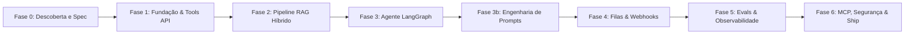

# Roadmap e Plano Detalhado de Implementação — Atendente IA

Este plano foi estruturado seguindo as diretrizes do `planning-and-task-breakdown` e do ritual do projeto. Cada fase é auto-contida, entregando fatias verticais testadas, com critérios de saída estritos e evidências de execução.

---

## Roadmap das Fases

---

## Detalhamento por Fase

### Fase 0: Descoberta e Especificação (Fase Atual)
- **Objetivo:** Estabelecer a base formal de arquitetura, contratos de especificação, ADRs e o primeiro grafo de conhecimento do projeto.
- **Tarefas:**
  1. `[x]` Definir especificação formal com escopo e suposições em `docs/SPEC.md`.
  2. `[x]` Estruturar visão de arquitetura hexagonal com diagramas Mermaid em `docs/ARCHITECTURE.md`.
  3. `[x]` Redigir ADRs técnicos essenciais em `docs/adr/` (ADR-0001 a ADR-0005).
  4. `[x]` Elaborar roadmap completo em `docs/PLAN.md`.
  5. `[ ]` Construir o primeiro grafo de conhecimento com `/graphify .` (ou CLI `graphify .`) e salvar relatório inicial em `docs/graph/GRAPH_REPORT_fase-0.md`.
  6. `[ ]` Criar arquivo `docs/graph/INSIGHTS.md` com análise inicial da topologia documental.
- **Critério de Saída:** Documentação completa, grafo gerado sem erros e repositório com branch limpa aguardando aprovação para a Fase 1.

---

### Fase 1: Fundação e API de Tools
- **Objetivo:** Criar a estrutura base do projeto com `uv`, Docker Compose para Postgres/Mongo/Redis, migrações Alembic (padrão expand/contract), modelos de domínio, contratos Pydantic v2 e endpoints REST das 8 Tools com auditoria no MongoDB e imposição de camadas com `import-linter`.
- **Tarefas:**
  1. Configurar `pyproject.toml`, `.env.example`, `Makefile`, `docker-compose.yml`, `.pre-commit-config.yaml` e CI no GitHub Actions.
  2. Implementar modelos de domínio em `src/atendente/domain/` (clientes com validação de CPF/CNPJ, pedidos, contratos SLA, faturas e chamados).
  3. Configurar persistência com SQLAlchemy 2 + Alembic em `src/atendente/infra/db/` e migração inicial.
  4. Implementar contratos e execução das 8 Tools em `src/atendente/tools/`:
     - `identificar_cliente`
     - `consultar_pedido`
     - `solicitar_reembolso` (sensível, com verificação de prazo de 7 dias)
     - `abrir_chamado` (com cálculo de SLA para B2B)
     - `consultar_contrato_sla`
     - `consultar_fatura`
     - `buscar_base_conhecimento` (interface inicial)
     - `transferir_para_humano`
  5. Criar repositório MongoDB de auditoria (`tool_audit_logs`) para registrar entradas, saídas e erros de cada Tool.
  6. Configurar `.importlinter` garantindo isolamento da camada de domínio: `domain` não importa `api`, `infra`, `agent`, `tools`.
  7. Criar suíte de testes unitários e de propriedades com Hypothesis para validadores de CPF/CNPJ e esquemas de Tools.
  8. Validar ausência de dependência de `domain` para `infra` com `graphify path "domain" "infra"`.
- **Critério de Saída:** `uv run lint-imports` verde, testes com cobertura >= 85% no domínio e nas Tools, migrações e seeds funcionais.

---

### Fase 2: Pipeline de RAG
- **Objetivo:** Implementar pipeline de ingestão semântica de 25 a 40 documentos corporativos fictícios da NovaLoja, busca híbrida (pgvector + BM25 via `tsvector`), metadados segregados por segmento (B2C/B2B), citações de fontes e mecanismo de abstenção por relevância.
- **Tarefas:**
  1. Elaborar corpus documental da NovaLoja em `data/kb/` (políticas B2C, SLAs contratuais B2B, FAQs e manuais).
  2. Implementar particionador semântico por seção com sobreposição em `src/atendente/rag/ingestion.py`.
  3. Testar e comparar 3 configurações de chunking (256, 512 e 1024 tokens) registrando métricas de Hit Rate@k e MRR no ADR-0004.
  4. Configurar tabela `kb_chunks` no PostgreSQL com coluna `embedding vector(1536)` (ou dimensão correspondente) e `tsvector` com índice GIN.
  5. Implementar serviço de busca híbrida com Reciprocal Rank Fusion (RRF) e filtros de segmento em `src/atendente/rag/retriever.py`.
  6. Implementar regras de abstenção com limiar mínimo de similaridade.
  7. Criar testes automatizados de retrieval ponta a ponta.
- **Critério de Saída:** Ingestão de documentos executada via `make ingest`, testes de busca híbrida aprovados com citações e abstenção comprovada em casos de baixa relevância.

---

### Fase 3: Agente e Grafo de Conversação
- **Objetivo:** Desenvolver o grafo de conversação cíclico com LangGraph, estado tipado `ConversationState`, checkpointing, sumarização automática e gatekeeper de ações sensíveis.
- **Tarefas:**
  1. Definir o esquema `ConversationState` e memória em `src/atendente/agent/state.py`.
  2. Implementar interface `LLMClient` (OpenAI, Gemini, Anthropic e Mock determinístico).
  3. Construir os nós do grafo em `src/atendente/agent/nodes/`:
     - Identificação e autenticação do cliente;
     - Classificação de intenção estruturada;
     - Recuperação RAG e injeção controlada de contexto;
     - Decisão de Tool / Function Calling;
     - Gatekeeper de confirmação para ações sensíveis;
     - Geração de resposta final;
     - Avaliação de handoff humano (falhas repetidas, pedido explícito ou injection).
  4. Configurar arestas condicionais e checkpoint no Redis.
  5. Implementar nó de sumarização automática para histórico longo (> N turnos).
  6. Aplicar `doubt-driven-development` sobre os fluxos de reembolso e handoff.
  7. Executar testes E2E conversacionais (reembolso com confirmação, chamado B2B e conversas longas).
  8. Executar `/code-simplify` ao fim da fase.
- **Critério de Saída:** Conversas de 30+ turnos mantendo contexto sem estouro de tokens, ações sensíveis bloqueadas sem confirmação e cobertura ampla com mocks.

---

### Fase 3b: Engenharia de Prompts e Janela de Contexto
- **Objetivo:** Estruturar catálogo versionado de prompts com orçamentação rígida de tokens por seção, proteção contra injection e benchmarks comparativos.
- **Tarefas:**
  1. Criar estrutura versionada em `src/atendente/agent/prompts/` (sistema, classificação, RAG, resposta).
  2. Aplicar técnicas de engenharia: instruções por papel, few-shot por intenção, saída estruturada por schema Pydantic, delimitação de contexto RAG com tags seguras e checklist de autoverificação.
  3. Implementar verificador estrito de orçamento de tokens por seção (sistema, histórico, RAG, tools).
  4. Comparar no mínimo 3 versões de prompts e registrar resultados em `docs/EVALS.md`.
- **Critério de Saída:** Testes garantindo que os prompts respeitam os limites de orçamento de tokens e que injeções no contexto do RAG são neutralizadas.

---

### Fase 4: Assincronismo e Webhooks
- **Objetivo:** Implementar recepção de webhooks protegida por HMAC SHA-256, fila assíncrona com Celery + Redis, controle de idempotência e Dead Letter Queue.
- **Tarefas:**
  1. Implementar middleware/dependência FastAPI de validação de assinatura HMAC no endpoint `/webhook/messages`.
  2. Configurar controle de idempotência via Redis com chave única.
  3. Desenvolver tarefas Celery para processar mensagens assincronamente através do grafo de conversação.
  4. Configurar política de retentativas com backoff exponencial e Dead Letter Queue (`dlq_unhandled_messages`).
  5. Aplicar skill `security-and-hardening` para auditar proteção contra ataques de replay e payloads maliciosos.
  6. Testar resiliência com simulação de falhas transitórias e descarte de duplicatas.
- **Critério de Saída:** API respondendo webhooks em < 200 ms, retentativas automáticas funcionando e DLQ capturando mensagens irrecuperáveis.

---

### Fase 5: Observabilidade, Evals e Ciclo de Debug
- **Objetivo:** Integrar Langfuse self-hosted para tracing, exportar métricas Prometheus, provisionar dashboards no Grafana, montar suíte de evals (>= 80 casos) e estabelecer playbook de depuração.
- **Tarefas:**
  1. Configurar contêineres de Langfuse, Prometheus e Grafana no `docker-compose.yml`.
  2. Instrumentar `LLMClient`, ferramentas e nós do LangGraph para exportar traces detalhados com hash do prompt, custo e tokens para o Langfuse.
  3. Configurar endpoint `/metrics` no FastAPI com métricas de negócio e latência.
  4. Provisionar dashboards versionados em `infra/grafana/dashboards/`.
  5. Montar dataset de evals com no mínimo 80 casos rotulados (intenções, tools, argumentos e respostas) em `evals/datasets/`.
  6. Desenvolver avaliadores determinísticos e LLM-as-a-judge com rubricas versionadas em `evals/judges/`.
  7. Implementar ferramenta `make trace-to-test TRACE_ID=...` para capturar traces anômalos e convertê-los em casos de teste.
  8. Redigir `docs/DEBUG_PLAYBOOK.md` com análise detalhada de 3 casos reais investigados.
  9. Implementar monitor de retrieval para chunks órfãos ou com baixa relevância.
- **Critério de Saída:** Langfuse e Grafana coletando dados em tempo real, suíte de 80 evals rodando no CI com threshold de aprovação e playbook de debug documentado.

---

### Fase 6: Segurança, MCP e Entrega Final
- **Objetivo:** Implementar servidor MCP oficial em Python expondo as Tools de atendimento, auditar segurança completa, rodar testes de carga Locust, executar `/code-simplify`, `/review` e `/ship`, gerando documentação final e relatório de entrega.
- **Tarefas:**
  1. Desenvolver servidor MCP em `src/atendente/mcp_server/` expondo as ferramentas para clientes externos.
  2. Implementar guardrails adicionais de sanitização de PII e bloqueio de prompt injection direto e indireto.
  3. Executar teste de carga com Locust comprovando p95 da API < 300 ms (excluindo tempo do LLM).
  4. Executar `/code-simplify` para limpeza de complexidade desnecessária.
  5. Executar `/review` completo de código e qualidade.
  6. Executar `/ship` (code-reviewer + security-auditor + test-engineer) gerando o parecer go/no-go em `docs/SHIP_REPORT.md`.
  7. Confeccionar `README.md` completo com guia rápido de 5 minutos, arquitetura, decisões técnicas e lista de melhorias futuras.
- **Critério de Saída:** Todas as verificações do Definition of Done (DoD) atendidas, CI verde e relatório `docs/SHIP_REPORT.md` aprovado.
