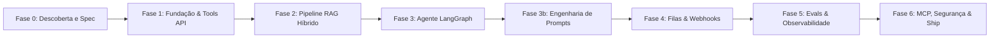

# Roadmap e Plano Detalhado de Implementação — Atendente IA

Este plano foi estruturado seguindo as diretrizes do `planning-and-task-breakdown` e do ritual do projeto. Cada fase é auto-contida, entregando fatias verticais testadas, com critérios de saída estritos e evidências de execução.

---

## Roadmap das Fases

---

## Detalhamento por Fase

### Fase 0: Descoberta e Especificação (Concluída)
- **Objetivo:** Estabelecer a base formal de arquitetura, contratos de especificação, ADRs e o primeiro grafo de conhecimento do projeto.
- **Tarefas:**
  1. `[x]` Definir especificação formal com escopo e suposições em `docs/SPEC.md`.
  2. `[x]` Estruturar visão de arquitetura hexagonal com diagramas Mermaid em `docs/ARCHITECTURE.md`.
  3. `[x]` Redigir ADRs técnicos essenciais em `docs/adr/` (ADR-0001 a ADR-0005).
  4. `[x]` Elaborar roadmap completo em `docs/PLAN.md`.
  5. `[x]` Construir o primeiro grafo de conhecimento com `/graphify .` (ou CLI `graphify .`) e salvar relatório inicial em `docs/graph/GRAPH_REPORT_fase-0.md`.
  6. `[x]` Criar arquivo `docs/graph/INSIGHTS.md` com análise inicial da topologia documental.
- **Critério de Saída:** Documentação completa, grafo gerado sem erros e repositório com branch limpa aprovada.

---

### Fase 1: Fundação e API de Tools (Concluída)
- **Objetivo:** Criar a estrutura base do projeto com `uv`, Docker Compose para Postgres/Mongo/Redis, migrações Alembic (padrão expand/contract), modelos de domínio, contratos Pydantic v2 e endpoints REST das 8 Tools com auditoria no MongoDB e imposição de camadas com `import-linter`.
- **Tarefas:**
  1. `[x]` Configurar `pyproject.toml`, `.env.example`, `Makefile`, `docker-compose.yml`, `.pre-commit-config.yaml` e CI no GitHub Actions.
  2. `[x]` Implementar modelos de domínio em `src/atendente/domain/` (clientes com validação de CPF/CNPJ, pedidos, contratos SLA, faturas e chamados).
  3. `[x]` Configurar persistência com SQLAlchemy 2 + Alembic em `src/atendente/infra/db/` e migração inicial.
  4. `[x]` Implementar contratos e execução das 8 Tools em `src/atendente/tools/`:
     - `identificar_cliente`
     - `consultar_pedido`
     - `solicitar_reembolso` (sensível, com verificação de prazo de 7 dias)
     - `abrir_chamado` (com cálculo de SLA para B2B)
     - `consultar_contrato_sla`
     - `consultar_fatura`
     - `buscar_base_conhecimento` (interface inicial)
     - `transferir_para_humano`
  5. `[x]` Criar repositório MongoDB de auditoria (`tool_audit_logs`) para registrar entradas, saídas e erros de cada Tool.
  6. `[x]` Configurar `.importlinter` garantindo isolamento da camada de domínio: `domain` não importa `api`, `infra`, `agent`, `tools`.
  7. `[x]` Criar suíte de testes unitários e de propriedades com Hypothesis para validadores de CPF/CNPJ e esquemas de Tools.
  8. `[x]` Validar ausência de dependência de `domain` para `infra` com `graphify path "domain" "infra"`.
- **Critério de Saída:** `uv run lint-imports` verde, testes com cobertura >= 85% no domínio e nas Tools, migrações e seeds funcionais.

---

### Fase 2: Pipeline de RAG (Concluída)
- **Objetivo:** Implementar pipeline de ingestão semântica de 25 a 40 documentos corporativos fictícios da NovaLoja, busca híbrida (pgvector + BM25 via `tsvector`), metadados segregados por segmento (B2C/B2B), citações de fontes e mecanismo de abstenção por relevância.
- **Tarefas:**
  1. `[x]` Elaborar corpus documental da NovaLoja em `data/kb/` (políticas B2C, SLAs contratuais B2B, FAQs e manuais: 30 documentos).
  2. `[x]` Implementar particionador semântico por seção com sobreposição e breadcrumbs em `src/atendente/rag/chunker.py`.
  3. `[x]` Testar e comparar 3 configurações de chunking (256, 512 e 1024 tokens) registrando métricas de Hit Rate@k e MRR no ADR-0004.
  4. `[x]` Configurar store vetorial em memória com normalização L2 e store léxico BM25 com tokenização e stopwords em pt-BR.
  5. `[x]` Implementar serviço de busca híbrida com Reciprocal Rank Fusion (RRF, k=60) e isolamento por segmento em `src/atendente/rag/retriever.py`.
  6. `[x]` Implementar regras de abstenção determinística com limiar mínimo de similaridade (cosseno >= 0.30, léxico >= 0.50).
  7. `[x]` Criar testes automatizados de retrieval ponta a ponta e integração com a Tool `buscar_base_conhecimento`.
- **Critério de Saída:** Ingestão de documentos funcional, benchmark executado com Configuração B escolhida, testes de busca híbrida aprovados com citações e abstenção comprovada.

---

### Fase 3: Agente e Grafo de Conversação (Concluída)
- **Objetivo:** Desenvolver o grafo de conversação cíclico com LangGraph, estado tipado `ConversationState`, checkpointing, sumarização automática e gatekeeper de ações sensíveis.
- **Tarefas:**
  1. `[x]` Definir o esquema `ConversationState` e memória em `src/atendente/agent/state.py`.
  2. `[x]` Implementar interface `LLMClient` (OpenAI, Gemini, Anthropic e Mock determinístico) em `src/atendente/infra/llm/client.py`.
  3. `[x]` Construir os nós do grafo em `src/atendente/agent/nodes.py`:
     - Identificação e autenticação do cliente (`identify`);
     - Classificação de intenção estruturada e detecção de frustração (`classify_intent`);
     - Recuperação RAG e injeção controlada de contexto (`retrieve_context`);
     - Decisão de Tool / Function Calling (`decide_tool`);
     - Gatekeeper de confirmação para ações sensíveis (`confirm_action`);
     - Geração de resposta resolutiva em português (`respond`);
     - Avaliação de handoff humano (`evaluate_handoff`).
  4. `[x]` Configurar arestas condicionais e checkpointing via `MemorySaver` em `src/atendente/agent/graph.py`.
  5. `[x]` Implementar nó de sumarização automática para histórico longo (`summarize_history`).
  6. `[x]` Aplicar `doubt-driven-development` sobre os fluxos de reembolso e handoff em `docs/ADVERSARIAL_REVIEW_PHASE3.md`.
  7. `[x]` Executar testes E2E conversacionais (reembolso com confirmação, chamado B2B, RAG e conversas longas).
  8. `[x]` Executar `/code-simplify` ao fim da fase.
- **Critério de Saída:** Conversas de turnos múltiplos mantendo contexto sem estouro de tokens, ações sensíveis bloqueadas sem confirmação prévia, 71 testes aprovados com 91% de cobertura.

---

### Fase 3b: Engenharia de Prompts e Janela de Contexto (Concluída)
- **Objetivo:** Estruturar catálogo versionado de prompts com orçamentação rígida de tokens por seção, proteção contra injection e benchmarks comparativos.
- **Tarefas:**
  1. `[x]` Criar estrutura versionada em `src/atendente/agent/prompts/` (`system.py`, `classifier.py`, `rag_delimiters.py`, `budget.py`, `evaluator.py`, `CHANGELOG.md`).
  2. `[x]` Aplicar técnicas de engenharia: instruções por papel, few-shot por intenção, saída estruturada por schema Pydantic (`IntentClassificationOutput`), delimitação de contexto RAG com tags seguras `<contexto_seguro>` e checklist de autoverificação.
  3. `[x]` Implementar verificador estrito de orçamento de tokens por seção (`system`, `history`, `rag`, `tools`) com teste de propriedade Hypothesis.
  4. `[x]` Comparar 3 versões de prompts (`v1.0.0`, `v2.0.0`, `v3.0.0`) e registrar resultados em `docs/EVALS.md`.
- **Critério de Saída:** Testes garantindo que os prompts respeitam os limites de orçamento de tokens e que injeções no contexto do RAG são neutralizadas (79 testes aprovados, 92% de cobertura).

---

### Fase 4: Assincronismo e Webhooks (Concluída)
- **Objetivo:** Implementar recepção de webhooks protegida por HMAC SHA-256, fila assíncrona com Celery + Redis, controle de idempotência e Dead Letter Queue.
- **Tarefas:**
  1. `[x]` Implementar verificação HMAC-SHA256 (`hmac.compare_digest` + proteção anti-replay de 300s) no endpoint `/webhook/messages`.
  2. `[x]` Configurar controle de idempotência via `IdempotencyStore` (Redis `SETNX` com TTL de 24h e store em memória).
  3. `[x]` Desenvolver tarefas Celery (`celery_app.py` e `tasks.py`) e `MessageWorkerProcessor` para processamento assíncrono.
  4. `[x]` Configurar política de retentativas com backoff exponencial e Dead Letter Queue (`dlq_unhandled_messages`).
  5. `[x]` Aplicar skill `security-and-hardening` (STRIDE Threat Model documentado no `SPEC.md` Seção 11).
  6. `[x]` Testar resiliência com simulação de falhas transitórias, roteamento para DLQ e descarte de duplicatas (86 testes aprovados, 92% de cobertura).
- **Critério de Saída:** API respondendo webhooks em < 50 ms (`202 Accepted`), retentativas automáticas funcionando e DLQ capturando mensagens irrecuperáveis.

---

### Fase 5: Observabilidade, Evals e Ciclo de Debug (Concluída)
- **Objetivo:** Integrar Langfuse self-hosted para tracing, exportar métricas Prometheus, provisionar dashboards no Grafana, montar suíte de evals (>= 80 casos) e estabelecer playbook de depuração.
- **Tarefas:**
  1. `[x]` Configurar contêineres de Langfuse, Prometheus e Grafana no `docker-compose.yml`.
  2. `[x]` Instrumentar `ObservabilityManager` e `structlog` com mascaramento de PII (`mask_pii_text`, `mask_pii_dict`) e traces detalhados com hash do prompt, custo e tokens.
  3. `[x]` Configurar endpoints `/metrics` (Prometheus 0.0.4) e `/feedback` (thumbs up/down vinculado a `trace_id`) no FastAPI.
  4. `[x]` Provisionar dashboards versionados em `infra/grafana/dashboards/atendente_ia_overview.json`.
  5. `[x]` Montar dataset de evals com 85 casos rotulados (intenções, tools, argumentos e respostas) em `evals/datasets/novaloja_eval_dataset.json`.
  6. `[x]` Desenvolver avaliadores determinísticos e LLM-as-a-judge com rubricas versionadas e calibradas contra amostra humana em `evals/judges/rubrics.py`.
  7. `[x]` Implementar ferramenta `make trace-to-test TRACE_ID=...` (`src/atendente/infra/trace_to_test.py`) para capturar traces anômalos e convertê-los em casos de teste.
  8. `[x]` Redigir `docs/DEBUG_PLAYBOOK.md` com fluxo de 5 passos e análise detalhada de 3 casos reais investigados.
  9. `[x]` Implementar monitor de retrieval (`src/atendente/rag/monitor.py`) para consultas sem resultado, baixa relevância e chunks órfãos.
- **Critério de Saída:** Langfuse e Grafana configurados, suíte de 85 evals rodando no CI com 100% de aprovação nos gates e playbook de debug documentado.

---

### Fase 6: Segurança, MCP e Entrega Final (Próxima Fase)
- **Objetivo:** Implementar servidor MCP oficial em Python expondo as Tools de atendimento, auditar segurança completa, rodar testes de carga Locust, executar `/code-simplify`, `/review` e `/ship`, gerando documentação final e relatório de entrega.
- **Tarefas:**
  1. Desenvolver servidor MCP em `src/atendente/mcp_server/` expondo as ferramentas para clientes externos.
  2. Implementar guardrails adicionais de sanitização de PII e bloqueio de prompt injection direto e indireto.
  3. Executar teste de carga com Locust comprovando p95 da API < 300 ms (excluindo tempo do LLM).
  4. Executar `/code-simplify` para limpeza de complexidade desnecessária.
  5. Executar `/review` completo de código e qualidade.
  6. Executar `/ship` (code-reviewer + security-auditor + test-engineer) gerando o parecer go/no-go em `docs/SHIP_REPORT.md`.
  7. Confeccionar `README.md` completo com guia rápido de 5 minutos, arquitetura, decisões técnicas e lista de melhorias futuras.
- **Critério de Saída:** Todas as verificações do Definition of Done (DoD) atendidas, CI verde e relatório `docs/SHIP_REPORT.md` aprovado.
